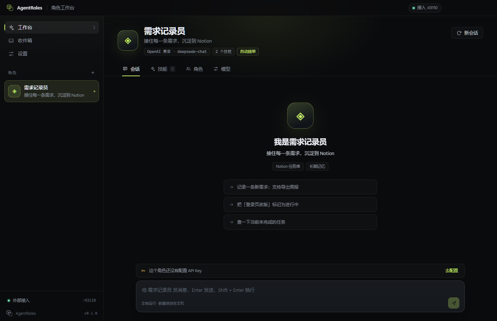
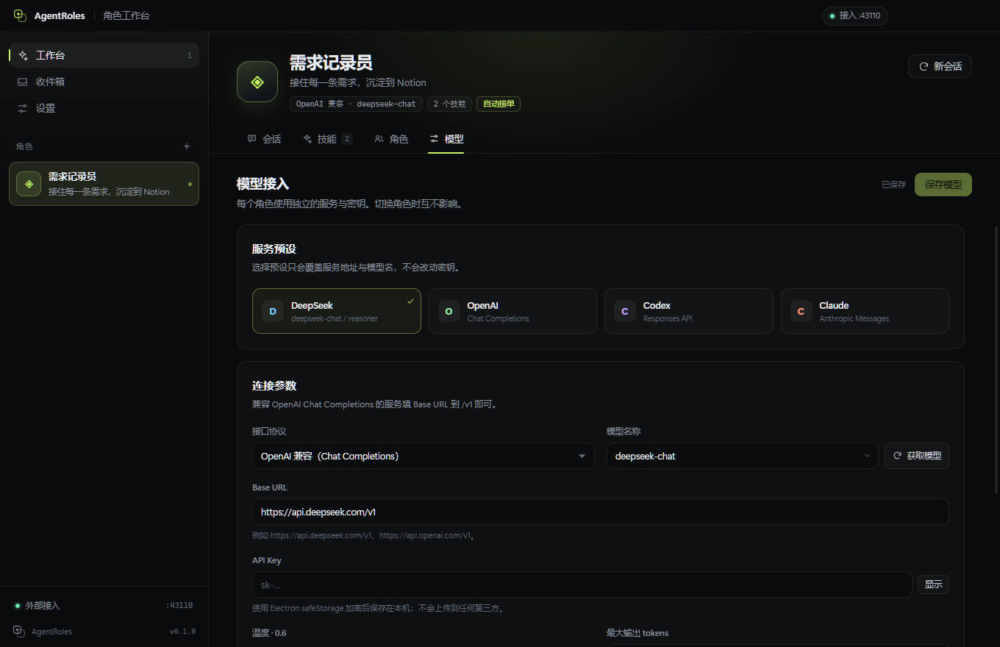
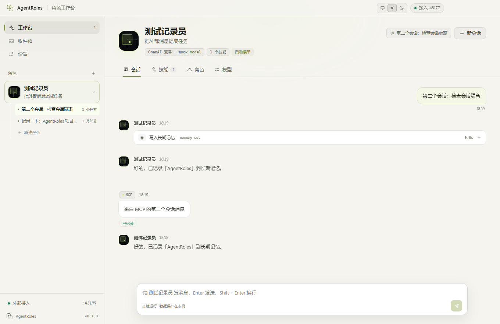
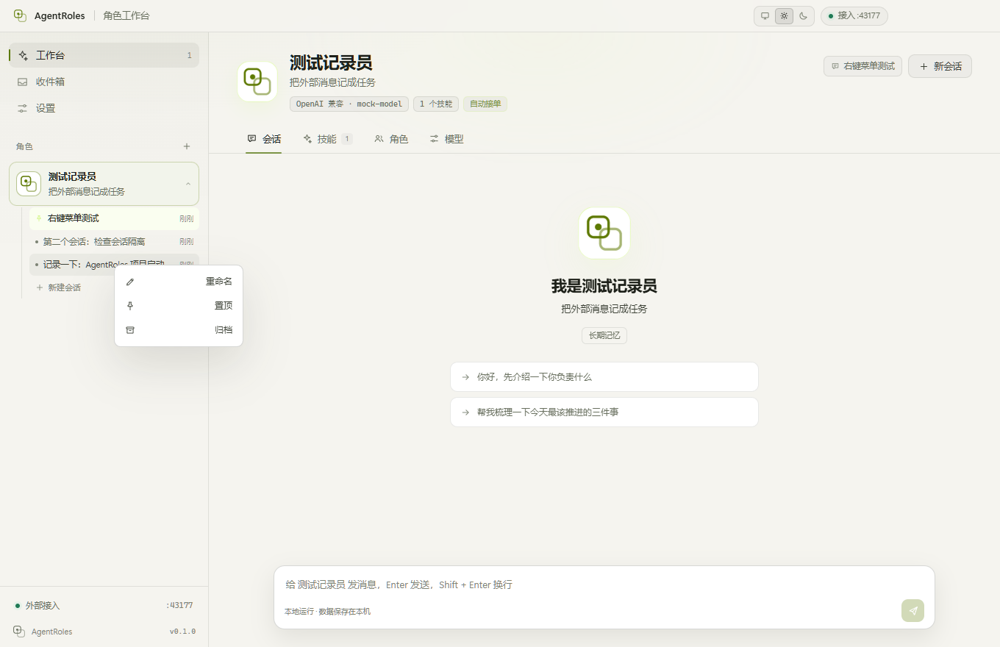
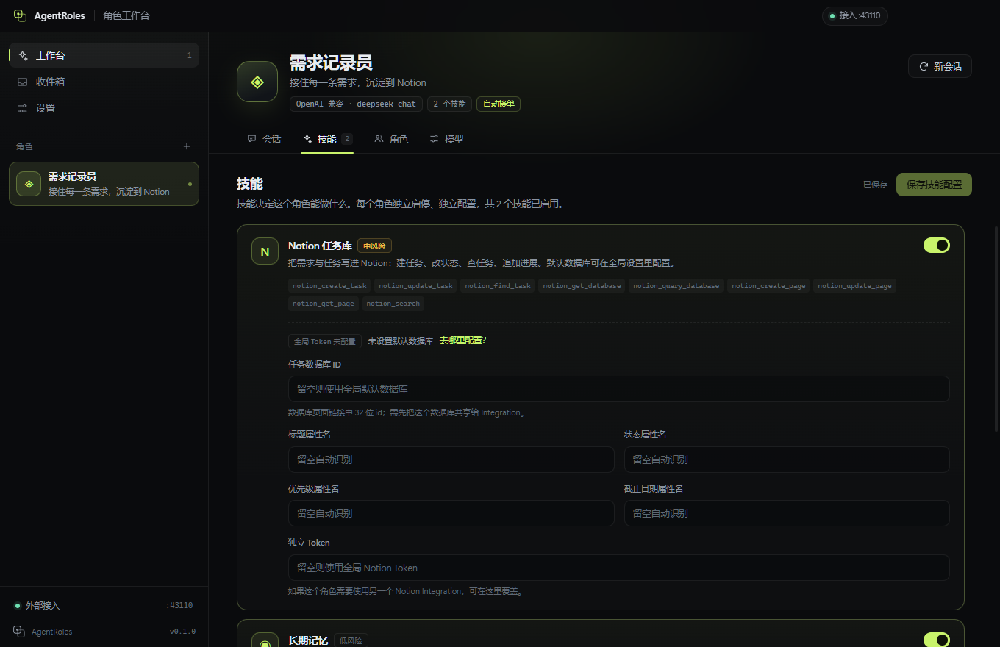

# AgentRoles

> 每个角色，一个独立智能体。

AgentRoles 是一个本地优先的桌面多 Agent 工作台。你可以为「需求记录员」「代码评审员」「研究助理」等角色分别配置：

- 独立的角色职责（直接作为 system prompt 主体）
- 独立的模型服务与 API Key（DeepSeek / OpenAI / Codex / Claude / 任意 OpenAI 兼容服务）
- 独立的技能组合（Notion、长期记忆、本地文件、HTTP、终端）
- 独立的会话与外部消息收件箱

外部 Agent（Codex、Claude Code、DSH、脚本）可以通过 **HTTP / MCP / CLI** 把消息投递给指定角色。内置示例「需求记录员」会把需求整理成任务并写入你的 Notion。



## 核心能力

| 能力 | 说明 |
| --- | --- |
| 多角色 | 每个角色有独立职责、强调色与运行状态；头像支持符号或上传图片 |
| 多会话 | 每个角色可有多条独立会话，侧边栏展开角色即可切换历史会话；首条消息自动生成标题 |
| 独立模型 | 每个角色单独配置服务地址、Key、模型、温度与最大 tokens；支持一键从服务端拉取模型列表并选择 |
| 可编辑职责 | 内置角色模板，职责描述就是该角色的系统提示词 |
| 独立技能 | 按角色启停技能；Notion 还支持独立数据库与 Token 覆盖 |
| 工具调用 | 流式对话 + 多轮工具调用，工具结果以卡片展示 |
| 外部投递 | 本地 HTTP API、MCP Server（stdio）、CLI 三种入口 |
| 收件箱 | 外部消息统一入箱，可自动处理，也可人工确认后处理 |
| 主题 | 深色 / 浅色 / 跟随系统，三档入口位于标题栏，原生标题栏同步配色 |
| 可访问性 | 强调色色块悬浮显示中文色名、色调提示与色值，便于色弱用户区分 |
| Notion | 创建任务、更新状态、查任务、追加进展，自动识别属性 |
| 本地优先 | 配置、会话、密钥都在本机；HTTP 只监听 127.0.0.1 |

## 快速开始

要求 Node.js 22+ 与 npm。

```bash
npm install
npm run dev
```

首次启动会自动创建一个「需求记录员」示例角色，并启用 Notion 与长期记忆技能。

如果 Electron 二进制下载缓慢，可以在安装前设置镜像：

```powershell
$env:ELECTRON_MIRROR = "https://npmmirror.com/mirrors/electron/"
npm install
```

### 第一次配置

1. **模型**：进入角色 →「模型」，选择预设或填入 OpenAI 兼容 / Anthropic 服务与 Key；点「获取模型」可从服务端拉取模型列表，也可以直接手动输入模型名。保存后点「测试连接」。
2. **Notion**：在「设置 → Notion 集成」填写 Integration Token 与默认数据库 ID，点「测试 Notion」。记得在 Notion 中把数据库共享给该 Integration。
3. **角色**：「角色」页可以修改职责、套用模板、决定是否自动处理外部消息。
4. **技能**：「技能」页按需启停。Notion 技能可以覆盖数据库 ID 与属性名。
5. **外部接入**：「设置 → 外部接入」可以看到端口、Token、cURL / MCP / CLI 示例。



### 构建与打包

```bash
npm run build       # 生成 out/
npm start           # 以生产构建启动
npm run dist:win    # 生成 Windows 安装包到 release/
```

开发构建未配置代码签名，Windows 可能提示「未知发布者」；正式分发前请配置签名证书。

## 多会话

每个角色可以拥有多条会话，历史记录按会话隔离保存：

- 点击侧边栏角色右侧的展开箭头，查看该角色的历史会话并切换
- 点击角色行会选中该角色并展开会话列表
- 右键会话可重命名、置顶或归档；置顶会话排在最前
- 归档会话收进「已归档」分组，可展开查看、取消归档
- 「新会话」按钮或会话列表底部的「新建会话」会创建一条新线程
- 首条用户消息会自动成为会话标题；手动重命名后不会再被自动覆盖
- 不同会话的上下文互不混合，同一角色的多条会话可以各自运行





## 内置技能

| 技能 | 工具 | 默认 | 说明 |
| --- | --- | --- | --- |
| Notion 任务库 | `notion_create_task` `notion_update_task` `notion_find_task` 等 9 个 | 关闭 | 建任务、改状态、查任务、原生属性操作 |
| 长期记忆 | `memory_set/get/list/delete` | 开启 | 每个角色一份跨会话记忆 |
| 本地文件 | `fs_list/read/write/append` | 关闭 | 限定在工作区目录内 |
| 网络请求 | `http_request` | 关闭 | GET/POST 等，用于网页或内部 API |
| 终端命令 | `run_command` | 关闭 | 在工作区执行命令，高风险 |

> 终端与文件技能具备操作本机的能力，只应在可信角色上启用。技能是否启用就是权限边界。



## 外部 Agent 接入

在「设置 → 外部接入」开启服务后，任意本机程序都可以投递消息：

```bash
curl -X POST http://127.0.0.1:43110/v1/agents/需求记录员/messages \
  -H "Authorization: Bearer <token>" \
  -H "Content-Type: application/json" \
  -d '{"content":"登录页改版，周五前完成","source":"codex","title":"登录页改版"}'
```

MCP 客户端（Codex / Claude Code / DSH）配置：

```json
{
  "mcpServers": {
    "agentroles": {
      "command": "node",
      "args": [
        "C:\\path\\to\\AgentRoles\\resources\\mcp-server.mjs",
        "--url", "http://127.0.0.1:43110",
        "--token", "<token>"
      ]
    }
  }
}
```

接入后，客户端会看到 `agentroles_list_agents` 与 `agentroles_send_message` 两个工具。

CLI：

```bash
node resources/agentroles-cli.mjs send \
  --agent "需求记录员" \
  --content "把登录页改版的截止时间改到周五" \
  --source codex
```

完整配置、HTTP API 字段与故障排查见 [docs/integrations.md](docs/integrations.md)。

## Notion 怎么接

1. 在 <https://www.notion.so/my-integrations> 创建 Internal Integration，复制 Token。
2. 准备一个任务数据库，至少包含一个标题属性；推荐再包含 Status、Priority、Due date。
3. 在数据库页面右上角「… → Connections」把 Integration 加进来。
4. 复制数据库链接中的 32 位 ID，填入 AgentRoles 设置。
5. 在角色技能里启用「Notion 任务库」。

示例表结构、属性自动识别规则与常见错误见 [docs/notion.md](docs/notion.md)。

## 数据与安全

- 配置、会话、记忆保存在 Electron 的 `userData` 目录；界面「设置 → 工作区与数据」可以直接打开。
- API Key 与 Notion Token 使用 Electron `safeStorage` 加密后落盘（Windows 上由 DPAPI 提供保护）。
- 本地 HTTP 服务只绑定 `127.0.0.1`，所有写入接口都需要 Bearer Token。
- 渲染进程没有 Node 权限，通过 `contextBridge` 暴露白名单 IPC。
- Markdown 输出经过 DOMPurify 清洗；外部消息作为纯文本渲染。
- 应用不包含遥测、云同步或远程存储。

## 项目结构

```text
src/
  main/
    engine/       模型适配（OpenAI / Responses / Anthropic）与 Agent 运行循环
    skills/       技能注册表、Notion、文件、HTTP、记忆、终端
    ingress/      本地 HTTP 消息入口
    store.ts      配置、会话、密钥加密与持久化
    ipc.ts        渲染进程 IPC
  preload/        contextBridge API
  renderer/       React UI
  shared/         共享类型
resources/
  mcp-server.mjs   MCP stdio Server
  agentroles-cli.mjs
docs/             架构、接入与 Notion 指南
scripts/          测试与辅助脚本
```

更详细的设计说明见 [docs/architecture.md](docs/architecture.md)。

## 开发与验证

```bash
npm run typecheck           # 主进程 + 渲染进程
npm run test:notion         # 用模拟 Notion API 验证属性映射
npm run test:models         # 模型列表接口（OpenAI 兼容 / Anthropic）
npm run test:integrations   # MCP Server + CLI
npm run test:migration      # 旧版单会话消息迁移到默认会话
npm run test:e2e            # Playwright：工具循环、多会话/右键菜单、头像、主题与外部 session 路由
npm run test:all            # 全部
```

E2E 测试会使用临时 `userData`，不会污染你的真实配置。

## 已知限制

- 暂不支持删除会话；归档会话可以在侧边栏的「已归档」分组中恢复。
- 没有多人协作与云端同步；每台机器各自运行。
- Notion 使用 `2022-06-28` API 版本，尚未接入 2025 的 data sources 模型。
- 工具调用最多 10 轮；历史上下文按条数与字符数截断。
- 还没有图形化的工具执行审批；安全边界依赖技能开关与角色职责。

## License

MIT
